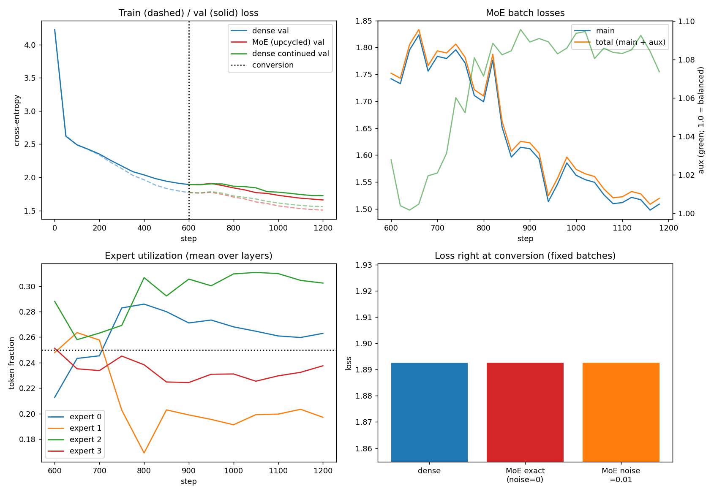

# Train a Dense (Linear-layer) Model, then Convert It into a Mixture-of-Experts

**Assignment:** Train a linear model and convert it into an MoE. Model size and data are my choice, but I must show that
both models continue to train and reduce loss.

**Result:** the dense model trained from scratch (val loss 4.23 → 1.89). I then converted it to an MoE with no loss of
function (1.8926 → 1.8926), and the MoE kept training (1.89 → **1.66**), beating a dense control that trained for the same
steps (1.72). All loss-reduction checks pass, and the full logs are in this repo.

## What I built

| Item | Choice |
|---|---|
| Data | Tiny Shakespeare, character-level (1,115,394 chars, vocab 65) |
| Dense model | 4-layer GPT, d_model 128, d_ff 512, 4 heads, block size 128, **0.82M params** |
| "Linear model" | The standard dense transformer, whose feed-forward blocks are stacks of linear layers. Those linear FFNs are what get converted. |
| MoE model | Each dense FFN becomes **4 experts, top-2 routing**, **2.40M total / 1.35M active params per token** |
| Training | AdamW, warmup + cosine LR, batch 32, CPU |
| Steps | 600 dense steps from scratch, then 600 MoE steps, plus a 600-step dense control |

## How the conversion works (sparse upcycling)

1. **Train the dense model** from scratch for 600 steps and save `dense.pt`.
2. **Convert to MoE.** Every dense FFN is copied into 4 identical experts. A new linear router is added to each layer.
   Attention, embeddings and LayerNorm are copied unchanged.
3. **Function preservation.** The experts are identical and the top-2 router weights are renormalised to sum to 1, so
   the MoE computes the same function as the dense model at the moment of conversion. I verified this on fixed
   validation batches:

   | Model | Val loss at conversion |
   |---|---|
   | Dense | 1.892581 |
   | MoE (noise = 0) | 1.892581 |
   | MoE (noise std 0.01 added to experts) | 1.892677 |

4. **Keep training the MoE.** The experts get small random noise so they can specialise. Training uses the main loss plus
   an auxiliary load-balancing loss (a Switch-style loss, where 1.0 means perfectly balanced).
5. **Control.** The same dense checkpoint is also trained for the same 600 steps with the same learning rate, so the MoE
   gain can be separated from "just more training".

## Results: both models keep training and loss goes down



Top-left: train (dashed) and val (solid) loss, with the dotted line marking conversion at step 600.
Top-right: MoE main loss, total loss and aux loss. Bottom-left: expert utilisation, averaged over layers.
Bottom-right: loss at the moment of conversion.

| Step | Dense train | Dense val | MoE train | MoE val | Dense-continued val |
|---|---|---|---|---|---|
| 0 | 4.2281 | 4.2283 | n/a | n/a | n/a |
| 300 | 2.1318 | 2.1702 | n/a | n/a | n/a |
| 600 (conversion) | 1.7700 | 1.8907 | 1.7701 | 1.8908 | 1.8907 |
| 900 | n/a | n/a | 1.6290 | 1.7693 | 1.8416 |
| 1200 (end) | n/a | n/a | 1.5058 | **1.6590** | 1.7237 |

### Automatic loss-reduction checks (printed at the end of training)

| Phase | Start val | End val | Drop | Result |
|---|---|---|---|---|
| Dense (from scratch) | 4.2283 | 1.8907 | 2.3376 | PASS |
| MoE (after conversion) | 1.8908 | 1.6590 | 0.2318 | PASS |
| Dense continued (control) | 1.8907 | 1.7237 | 0.1671 | PASS |
| MoE vs dense at conversion | 1.8907 | 1.6590 | 0.2317 | PASS |

All checks pass. After conversion the MoE reduced val loss by 0.23, versus 0.17 for the dense control trained for the
same number of steps.

### Expert utilisation

The load-balancing loss stayed close to 1.0 (about 1.0–1.10), so no expert collapsed. Mean token share across the four
experts ended between about 0.20 and 0.30 against an ideal of 0.25 (see the plot). Per-layer numbers are in
`results/summary.json`.

### Sample text (after 600 + 600 steps)

See `results/samples.txt` for the dense and MoE samples. They are character-level and imperfect, as expected for a
0.8M-parameter model trained for a few minutes on CPU.

## Training logs

- `training_log.txt` is the full console log of the run.
- `results/logs.json` has the structured logs (train/val loss every 50 steps, MoE main/aux loss, utilisation).
- `results/summary.json` and `results/report.md` have the final summary and checks.
- `results/dense.pt` and `results/moe.pt` are the checkpoints.

## Reproduce

```bash
pip install -r requirements.txt
python dense_to_moe.py --dense_steps 600 --moe_steps 600 --batch_size 32 --eval_iters 10 --eval_every 50
# quick smoke test:
python dense_to_moe.py --quick
```

The script downloads Tiny Shakespeare automatically. If the download fails, it falls back to a synthetic corpus.

## Notes and limitations

- This is a small CPU run, chosen to be reproducible in minutes. Absolute loss values are not competitive with larger models.
- The MoE has more total parameters (2.40M vs 0.82M), so part of its advantage over the control comes from added
  capacity, not only from routing. Compute per token is 1.35M active params versus 0.82M for the dense model.
- The result comes from a single run with one seed, so I would not read the gap between 1.66 and 1.72 as a precise measurement.
- Evaluation uses the same fixed validation batches for every model, so the numbers are directly comparable.
